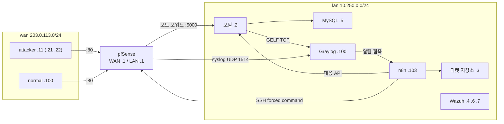

# 해담시청 SOAR 포트폴리오

팀 NoBugs(Aleph) 캡스톤 **해담시청 SOAR**를 PC 한 대에서 설치·실측할 수 있도록 다시 구성한 개인 포트폴리오입니다. 팀 4대 분산 환경(포털·pfSense·Graylog·n8n·Wazuh)을 Docker 네트워크로 옮기면서 팀 주소 체계(`203.0.113.x` / `10.250.0.x`)를 그대로 유지했습니다.

- **팀 원본:** [aleph-soar-capstone](https://github.com/NoBugs-Aleph/aleph-soar-capstone) · [haedam-portal-backend](https://github.com/NoBugs-Aleph/haedam-portal-backend) · [haedam-portal-frontend](https://github.com/NoBugs-Aleph/haedam-portal-frontend)
- **팀원:** A · B · C · D (담당은 [CREDITS.md](CREDITS.md))
- **본인(A):** 팀에서는 포털 서비스·대응 API와 S1·S4(계정 탈취) 담당. 이 저장소에서는 PC 한 대 구성 전체(compose, pfSense QEMU 컨테이너, Graylog·n8n 반입 스크립트, 티켓 실행기, 문서)를 작성하고 실측했습니다.

## 구성



| 구성 | lan 주소 | 호스트에서 접속 | compose 프로필 |
| --- | --- | --- | --- |
| 포털 | `10.250.0.2:5000` | http://127.0.0.1:8080 | (기본) |
| 티켓 저장소·보안 대시보드 | `10.250.0.3` | http://127.0.0.1:8089 | (기본) |
| MySQL | `10.250.0.5` | — | (기본) |
| Graylog | `10.250.0.100` | http://127.0.0.1:9000 | `soc` |
| n8n | `10.250.0.103` | http://127.0.0.1:5678 | `soc` |
| Wazuh manager·indexer·dashboard | `10.250.0.4`·`.6`·`.7` | https://127.0.0.1:5601 | `wazuh` |
| pfSense | WAN `203.0.113.1`, LAN `10.250.0.1` | 웹 https://127.0.0.1:8443, 설치 콘솔 http://127.0.0.1:8006 | `pfsense` |
| attacker · normal | `203.0.113.11`(.21 .22) · `203.0.113.100` | — | `lab` |

시민·공격자 쪽 요청은 반드시 pfSense를 거쳐 포털에 닿고, 포털의 응답도 pfSense로 돌아갑니다. 그래서 포털·Graylog가 보는 출발지가 실제 공격자 주소입니다.

## 사전 준비

- **Docker Desktop**(WSL2 백엔드). 메모리 12GB 이상을 WSL에 줍니다. `%UserProfile%\.wslconfig`:

  ```ini
  [wsl2]
  memory=12GB
  kernelCommandLine=sysctl.vm.max_map_count=262144
  ```

  저장 후 `wsl --shutdown`, Docker Desktop을 다시 켭니다.
- **KVM:** `docker run --rm --device /dev/kvm alpine ls -l /dev/kvm`이 성공해야 pfSense VM이 빠르게 돕니다.
- **Python 3.12 이상**(호스트에서 반입 스크립트·실행기를 돌림, 표준 라이브러리만 사용)
- **pfSense ISO:** [infra/pfsense/INSTALL.md 1절](infra/pfsense/INSTALL.md)의 명령으로 `infra/pfsense/iso/`에 받고 SHA-256을 확인합니다.

## 설치

### 1. `.env`

```powershell
Copy-Item .env.example .env
python -c "import secrets; print(secrets.token_urlsafe(24))"   # 값마다 새로 만들어 넣는다
```

`.env.example`의 주석대로 모든 `change-me`를 바꿉니다(Graylog SHA-256, Wazuh 비밀번호 규칙 포함). 값이 비어 있으면 compose가 변수 이름을 대며 기동을 거부합니다. `.env`와 `.local/`(SSH 개인키)은 git에 들어가지 않습니다.

### 2. Wazuh 인증서와 내부 사용자

```powershell
docker volume create haedam_wazuh-certs
docker compose -f infra/wazuh/generate-certs.yml run --rm generator
python infra/wazuh/make_users.py
```

### 3. 기동

```powershell
docker compose --profile "*" up -d --build
```

처음에는 이미지 빌드와 내려받기로 10분 이상 걸립니다.

### 4. pfSense 설치 (처음 한 번)

http://127.0.0.1:8006/vnc.html 콘솔에서 설치하고, 웹 설정·대응 도구·n8n 전용 SSH 키를 등록합니다. 순서는 [infra/pfsense/INSTALL.md](infra/pfsense/INSTALL.md) 2~4절을 그대로 따릅니다. 원격 syslog는 `10.250.0.100:1514`입니다.

### 5. Graylog·n8n 설정 반입

```powershell
python infra/graylog/bootstrap.py --live      # 입력·스트림·파이프라인·알림·이벤트 정의. 다시 돌려도 "생성 0"
python infra/n8n/load.py                      # 자격 증명·워크플로 반입, 웹훅·하위 워크플로 게시
```

- `--live`를 빼면 n8n이 관찰 모드(티켓 기록·차단 없음)로 돕니다. 실측에는 `--live`가 필요합니다.
- n8n 화면(http://127.0.0.1:5678)에 처음 들어가면 소유자 계정을 만듭니다.

### 6. 점검

```powershell
python tools/check_stack.py
```

```text
OK   portal        200 ...
OK   graylog       200 ALIVE
OK   n8n           200 {"status":"ok"}
OK   wazuh         200 ...
OK   pfsense       200
OK   ticket-store  200 {"ok":true,...}
```

6개가 모두 `OK`여야 합니다. 하나라도 `FAIL`이면 종료 코드 1입니다.

## 티켓 실측

**버튼으로:** `python lab/panel.py` → http://127.0.0.1:8099 실습 제어판(공격·효과 확인·해제 버튼, 티켓 상태 자동 갱신). 팀원과 공유할 땐 [docs/실습-제어판.md](docs/실습-제어판.md)(준비·화면 보는 법·규칙).

**직접 한 단계씩:** [docs/실습-안내.md](docs/실습-안내.md) — 공격 명령, Graylog·n8n·티켓 대시보드·pfSense에서 볼 것, 해제까지.

**반복 측정(자동):**

```powershell
python lab/run_ticket.py S10 --restore
```

| 티켓 | 출발지 | 입력 | 기대 대응 | 문서 |
| --- | --- | --- | --- | --- |
| S10 경계 차단·스캔·로그인 반복 | `203.0.113.22` | 스캔 404 → 로그인 401 → ping(pfSense 차단) | 포털 차단 + pfSense 차단 | [docs/tickets/S10](docs/tickets/S10/README.md) |
| S8 포털 스캔·로그인 반복 | `203.0.113.21` | 스캔 404 → 로그인 401 | 포털 차단(pfSense 호출 없음) | [docs/tickets/S8](docs/tickets/S8/README.md) |
| S1 로그인 무차별 대입 | `203.0.113.11` | 같은 계정 로그인 실패 9회 | 포털에서 출발지 차단, 같은 계정의 정상 로그인은 유지 | [docs/tickets/S1](docs/tickets/S1/README.md) |
| H1 민원 도배 | `203.0.113.11` | 같은 계정으로 민원 8건 연달아 등록 | 그 계정만 민원 작성 제한(429), 로그인·조회는 유지 | [docs/tickets/H1](docs/tickets/H1/README.md) |

실행기는 다음 순서로 진행하고 결과를 `docs/tickets/<ID>/runs.jsonl`에 한 줄씩 남깁니다.

1. 사전 점검: 같은 출발지의 탐지 창(S8·S10 15분, S1 30분)이 지났는지, 남은 차단이 없는지
2. `attacker` 컨테이너에서 입력
3. 티켓 대기(최대 180초. Graylog가 1분마다 평가하므로 보통 30~70초)
4. 효과: 공격자 403(S10은 연결 실패), `normal` 200
5. `--restore`: n8n `haedam-50`으로 해제(pfSense → 포털), 공격자 200 확인

집계는 `python tools/summarize_runs.py`가 [docs/정량평가.md](docs/정량평가.md)에 씁니다.

## 문제 해결

| 증상 | 원인 | 조치 |
| --- | --- | --- |
| pfSense 웹이 잠깐 되다가 끊김 | 컨테이너 안 브리지가 VM MAC을 바깥 포트에 학습 | entrypoint에서 바깥 포트 `learning off`(적용됨) |
| 포트 포워드는 되는데 연결이 RST로 끊김 | Docker가 lan으로 넘어간 `203.0.113.x` 출발지를 게이트웨이 주소로 바꿈 | wan 망 마스커레이드 끔(적용됨). wan 컨테이너는 인터넷 불가 |
| pfSense 웹이 `https://127.0.0.1/`로 튕김 | 저장 후 포트 없는 주소로 리다이렉트 | 주소에 `:8443`을 붙인다 |
| pfSense 차단 로그가 Graylog 검색에 안 나옴 | BSD syslog에 시간대가 없어 9시간 미래로 저장 | Syslog 입력 시간대 `Asia/Seoul`(bootstrap이 설정) |
| n8n 하위 워크플로 호출이 "Workflow is not active" | n8n 2.x는 미게시 하위 워크플로를 실행하지 않음 | `load.py`가 하위 워크플로도 게시 |
| Wazuh indexer·dashboard 재시작 반복 | 인증서를 못 읽음 / dashboard keystore `EACCES` | 2절 인증서 생성, dashboard 인증서는 `/usr/share/...`(적용됨) |
| pfSense만 남기고 다른 볼륨을 지운 뒤 S10 pfSense 차단이 `rejected:replay_needs_reconciliation` | 티켓 번호가 `T-<날짜>-0001`부터 다시 시작돼, pfSense 대응 도구 기록(`/cf/conf/haedam-pf-response/state.json`)의 예전 요청과 겹침 | 차단 테이블이 비었는지 확인하고 그 파일을 다른 이름으로 옮긴다. 전부 새로 설치하면 생기지 않음 |
| S10에서 pfSense 차단이 `outcome_needs_reconciliation` | `easyrule`이 테이블 반영(약 2초) 전에 끝나 즉시 읽기 실패 | 대응 도구가 반영을 기다리도록 수정(해시 `c9f561ba…`) |

자세한 경위는 [docs/journal/](docs/journal/)에 있습니다. 구성별 세부 문서: [pfSense](infra/pfsense/INSTALL.md) · [Wazuh](infra/wazuh/README.md) · [n8n](infra/n8n/README.md) · [Graylog](infra/graylog/README.md).

## 출처와 기여

원작 파일·고정 커밋·담당 범위는 [CREDITS.md](CREDITS.md)에 있습니다. 팀 산출물(포털, 티켓 저장소, 탐지 규칙, n8n 워크플로, pfSense 대응 도구)은 원작자의 것이며, 이 저장소에서 바꾼 부분은 커밋 이력과 작업 일지로 확인할 수 있습니다.
