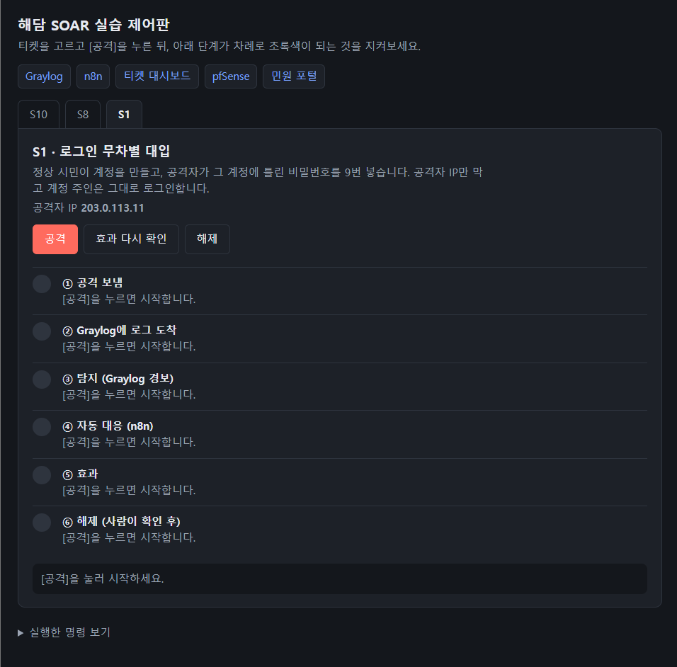
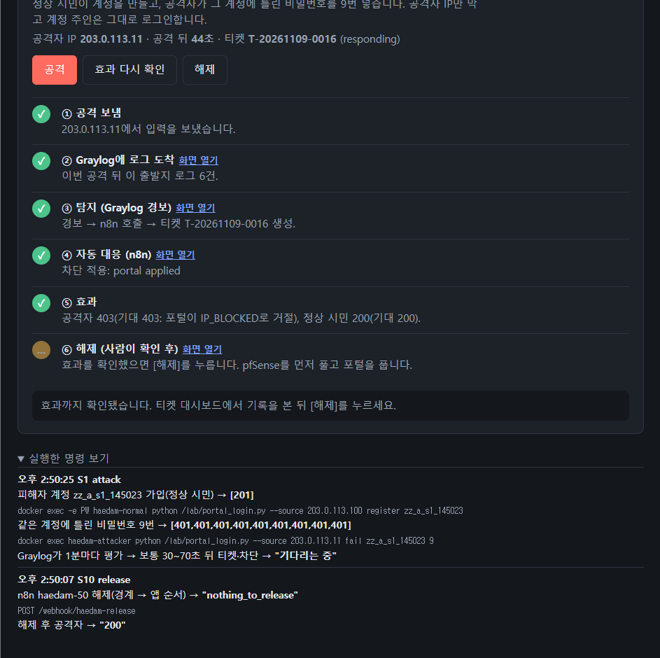
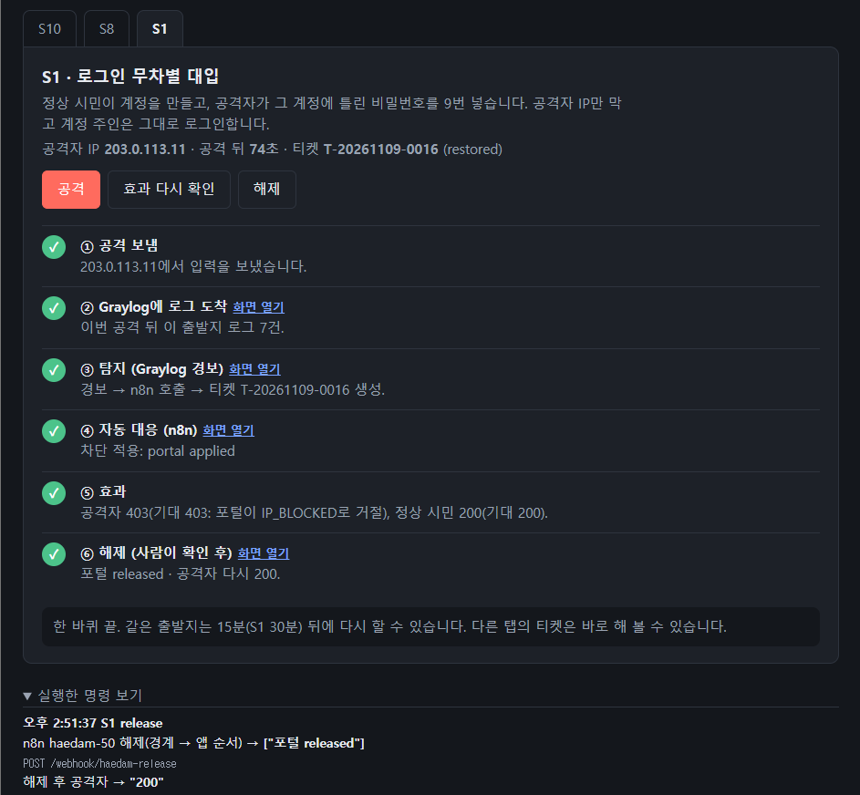
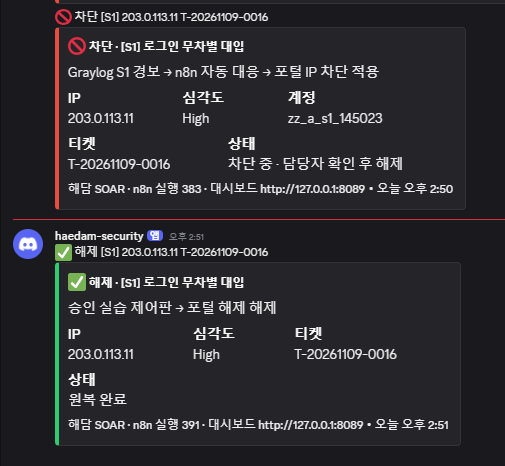

# 실습 제어판으로 해 보기 (팀원용)

버튼 세 개로 공격 → 효과 확인 → 해제를 하는 화면입니다. 명령을 외울 필요 없이 S10·S8·S1·S4·H1·H2·H3을 눌러 보고, 탐지·자동 대응·차단이 실시간으로 진행되는 걸 봅니다.

> 한 단계씩 손으로 치는 방식은 [실습-안내.md](실습-안내.md)에 있습니다. 이 문서는 그 명령을 버튼으로 돌리는 제어판만 다룹니다.

## 1. 준비 (각자 PC에서 한 번)

이 저장소를 받고 스택을 띄워야 합니다. 제어판은 이 PC의 Docker 컨테이너(`haedam-attacker` 등)를 직접 부르므로, 스택이 떠 있지 않으면 동작하지 않습니다.

```powershell
docker compose --profile "*" up -d          # 14개 컨테이너 기동
python tools/check_stack.py                 # 6개 모두 OK 확인

# 탐지·차단을 실제로 켜기 (이게 없으면 티켓이 안 생김)
$env:GRAYLOG_ADMIN_PASSWORD = (Select-String '^GRAYLOG_ADMIN_PASSWORD=' .env).Line.Split('=',2)[1]
$env:N8N_WEBHOOK_KEY        = (Select-String '^N8N_WEBHOOK_KEY=' .env).Line.Split('=',2)[1]
python infra/graylog/bootstrap.py --live    # "mode: live"가 보여야 함
```

`.env`는 저장소에 없습니다(비밀값). [.env.example](../.env.example)을 `.env`로 복사하고 값을 채운 뒤 시작하세요. n8n 워크플로·자격 증명은 처음 한 번 `python infra/n8n/load.py`로 반입합니다.

## 2. 제어판 열기

```powershell
python lab/panel.py        # http://127.0.0.1:8099 (브라우저가 자동으로 열림)
```

- `127.0.0.1`에만 열립니다. 다른 PC에서는 접속할 수 없습니다(각자 자기 PC에서 띄웁니다).
- 시작할 때마다 일회용 토큰을 만들어, 다른 사이트가 버튼을 대신 누르지 못하게 막습니다.
- 공격 명령은 모두 `haedam-attacker` 컨테이너 안에서만 돕니다. 이 PC 밖으로 나가지 않습니다.

## 3. 화면 보는 법

티켓(S10·S8·S1·S4·H1·H2·H3)마다 **[공격] · [효과 확인] · [해제]** 버튼이 있고, 그 아래 6단계가 5초마다 자동으로 갱신됩니다. S7·S12 탭은 탐지 정의·워크플로 반입 전이라 "연결 대기"로만 보입니다.

| 단계 | 보이는 것 |
| --- | --- |
| ① 공격 보냄 | 출발지에서 입력을 보냄 (S10 `.22`, S8 `.21`, S1·S4·H1·H2 `.11`). H3는 새 담당자 계정이 민원 3건 상태를 바꿈 |
| ② Graylog에 로그 도착 | pfSense·포털 로그가 Graylog에 들어옴 |
| ③ 탐지 (Graylog 경보) | 1분마다 조건 확인 → 경보 → 티켓 생성 (보통 30~70초) |
| ④ 자동 대응 (n8n) | 포털 차단, S10은 pfSense 차단까지. H1은 작성 제한, S4는 계정 잠금·세션 회수, H2는 IP 차단+계정 잠금, H3는 담당자 잠금+민원 복원 |
| ⑤ 효과 | 공격자는 막히고(S10 `000`·S8/S1/H2 `403`·H1 민원 작성 `429`·S4 맞는 비밀번호 로그인 `401`·H3 담당자 로그인 `401`), 정상 시민은 `200`(H1은 다른 시민의 민원 작성 `201`). H2는 다른 출발지에서도 공격 계정 로그인 `401`, H3는 신청자의 민원 3건이 모두 `접수`로 돌아와야 `200` |
| ⑥ 해제 | [해제]를 누르면 pfSense를 먼저 풀고 포털을 풂 → 공격자 다시 `200`. H1은 해제 웹훅이 작성 제한을 풀어 다시 `201`. H2는 1차 해제가 "계정 잠김"으로 보류되면 비밀번호를 재설정하고 다시 해제하며, 해제 뒤에도 타인 민원은 `403`. H3는 관리자가 담당자 잠금을 풀어 로그인 `200`이 되고, 이어서 해제 웹훅이 티켓을 닫음. 모든 티켓은 해제 뒤 `restored`가 되고 Discord에 원복 카드가 옴. S4는 비밀번호 재설정 뒤 계정 주인이 새 비밀번호로 `200`, 옛 비밀번호는 `401` |

각 단계의 링크를 누르면 Graylog Search·Alerts, n8n Executions, 티켓 대시보드가 열려 근거를 바로 볼 수 있습니다.

S1을 예로 한 바퀴 돌린 화면입니다.

| 시작 전 | 공격 뒤 44초: ①~⑤ 완료, 해제 대기 |
| --- | --- |
|  |  |
| **해제 뒤 (restored)** | **Discord 알림 (선택, `DISCORD_WEBHOOK_URL`)** |
|  |  |

## 4. 규칙 (안 지키면 결과가 틀어짐)

- **같은 출발지는 15분(S1은 30분, H1은 10분, H2는 5분)에 한 번만. S1·S4·H1·H2는 출발지(`.11`)가 같으니 이어서 누르지 않습니다(S4는 5분).** H3는 회차마다 새 계정이라 이 제한이 없습니다. Graylog가 같은 출발지 로그를 한 창으로 묶어 세므로, 연달아 누르면 앞 회차와 섞입니다. 다시 하려면 기다리거나 다른 티켓을 누릅니다.
- **⑤ 효과를 확인한 뒤에 ⑥ 해제를 누릅니다.** 사람이 확인하고 원복하는 순서가 핵심입니다.
- **처음부터 공격자가 `000`/`403`이면** 앞 회차 차단이 남은 것 → 먼저 [해제].

막히면 [실습-안내.md](실습-안내.md)의 "결과가 기대와 다를 때" 표를 보세요.

## 5. 버튼 없이 반복 측정

같은 티켓을 여러 번 자동으로 돌려 기록까지 남기려면:

```powershell
python lab/run_ticket.py S10 --restore      # 공격~해제를 한 번에, 결과는 docs/tickets/S10/runs.jsonl
python lab/h3/live.py                       # H3 한 회차, 결과는 docs/tickets/H3/runs.jsonl
```
